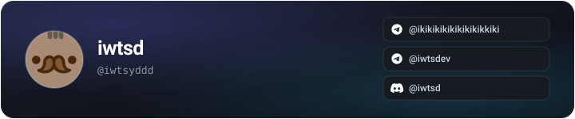

building software and breaking things in interesting ways.

  

 

**[DiEmu](https://github.com/iwtsyddd/DiEmu)** · Game Boy emulator in Rust  
**[iwtsd.online](https://github.com/iwtsyddd/iwtsyddd.github.io)** · personal portfolio & blog

 

&nbsp;&nbsp;&nbsp;

&nbsp;&nbsp;&nbsp;

&nbsp;&nbsp;&nbsp;

